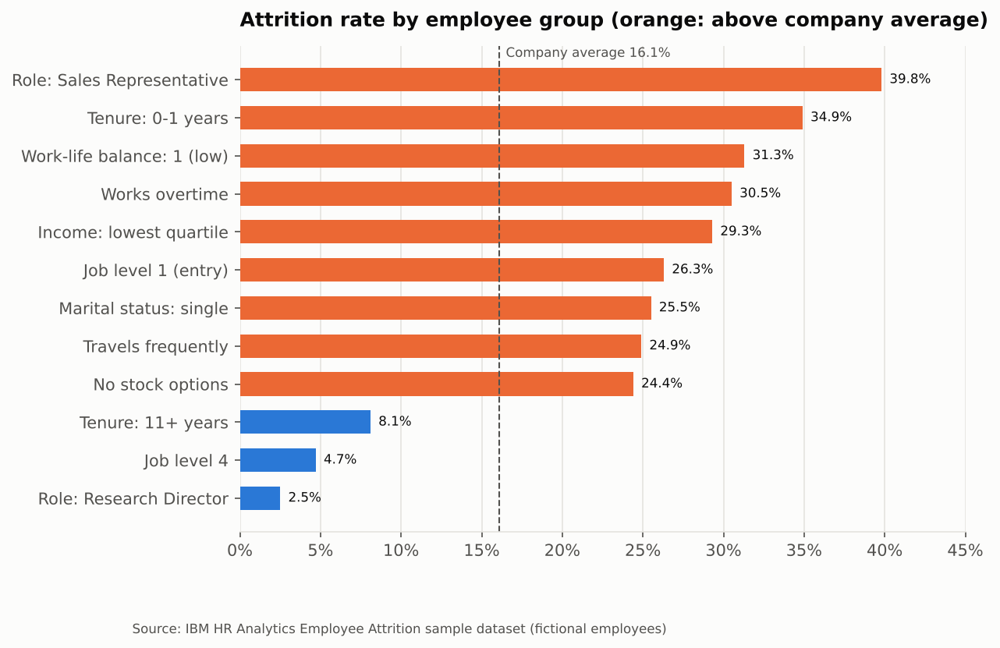
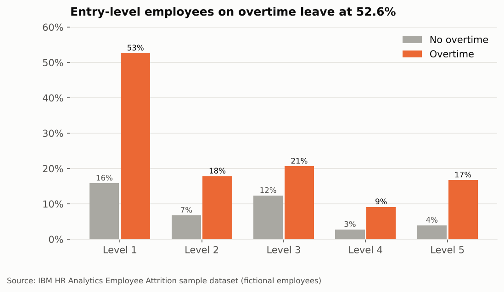
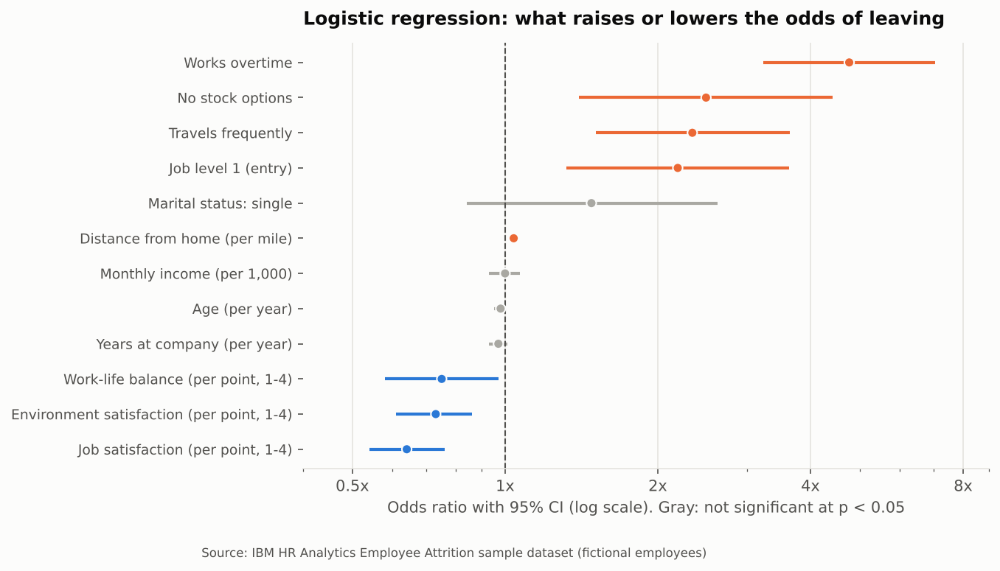

# HR People Analytics: Employee Attrition Drivers

Analysis of 1,470 employee records to identify who leaves, why, and what attrition costs. Combines SQL segmentation with a logistic regression risk model (holdout ROC AUC 0.81).

| | |
|---|---|
| **Industry** | Human Resources / People Analytics (cross-industry; dataset includes R&D and laboratory roles) |
| **Tools** | SQL (DuckDB), Python, pandas, statsmodels, scikit-learn, matplotlib |
| **Techniques** | Data quality profiling, rate and lift analysis, interaction analysis, logistic regression, odds ratios, holdout validation, cost modeling |
| **Data** | IBM HR Analytics Employee Attrition sample dataset (1,470 employees, 35 fields) |

---

## 1. Business Questions

1. Which employee groups have the highest attrition?
2. Which factors independently raise or lower the odds of leaving?
3. What does attrition cost, and where should retention spend go first?

## 2. Key Findings

| # | Finding | Evidence |
|---|---|---|
| 1 | Overall attrition is 16.1% (237 of 1,470). | `outputs/tables/01_data_quality.csv` |
| 2 | Overtime is the strongest driver. Employees on overtime leave at 30.5% vs 10.4%, and the model gives 4.8x higher odds after controlling for other factors. | `outputs/tables/02_attrition_by_factor.csv`, `06_model_odds_ratios.csv` |
| 3 | Risk compounds at entry level: Job Level 1 employees on overtime leave at 52.6%, vs 15.8% without overtime. | `outputs/tables/03_overtime_by_level.csv` |
| 4 | Attrition is front-loaded: 34.9% in the first year of tenure vs 8.1% after 11+ years. | `outputs/tables/02_attrition_by_factor.csv` |
| 5 | Sales Representatives (39.8%) and Laboratory Technicians (23.9%) have the highest role-level attrition. | Same table |
| 6 | No stock options (2.5x odds) and frequent travel (2.3x) are significant after controls. Income is not significant once job level is in the model. | `outputs/tables/06_model_odds_ratios.csv` |
| 7 | Each 1-point gain in job satisfaction lowers the odds of leaving by 36%. | Same table |
| 8 | Estimated replacement cost is $6.8M, and 52% of it comes from employees who worked overtime. | `outputs/tables/05_cost_of_attrition.csv` (assumes 50% of annual salary) |

**Recommendations:**

1. Audit overtime load for Job Level 1, starting with Sales Representatives and Laboratory Technicians.
2. Extend stock option eligibility to entry-level roles, where 47% of employees have none (vs 38% to 41% at higher levels).
3. Add a 90-day and 12-month check-in for new hires, since first-year attrition is 2.2x the company average.

## 3. Results

### 3.1 Attrition by employee group



### 3.2 Overtime and job level



### 3.3 Risk model (logistic regression)



| Metric | Value |
|---|---|
| Training / holdout rows | 1,029 / 441 (70/30 stratified split) |
| Holdout ROC AUC | 0.810 |
| McFadden pseudo R-squared | 0.222 |

## 4. Method

| Step | File | Description |
|---|---|---|
| Staging | `sql/00_staging.sql` | Loads raw data as text, casts types, drops constant columns, derives tenure bands and income quartiles |
| Data quality | `sql/01_data_quality.sql` | Duplicates, nulls, constant columns, base rate |
| Factor analysis | `sql/02_attrition_by_factor.sql` | Attrition rate and lift vs company average for 11 factors |
| Interaction | `sql/03_overtime_by_level.sql` | Overtime x job level |
| Profile | `sql/04_leaver_profile.sql` | Median profile of leavers vs stayers |
| Cost | `sql/05_cost_of_attrition.sql` | Replacement cost by department (parameterized assumption) |
| Model | `src/run_analysis.py` | Logistic regression on 12 features, odds ratios with 95% CI, holdout AUC |

## 5. Data Quality

| Check | Result |
|---|---|
| Rows | 1,470 |
| Duplicate employee IDs | 0 |
| Nulls in key fields | 0 |
| Constant columns removed | EmployeeCount, Over18, StandardHours (1 value each) |
| Class balance | 16.1% left, 83.9% stayed |

## 6. Limitations

- Fictional dataset created by IBM for HR analytics training. Use it to judge the method, not to benchmark a real workforce.
- Single snapshot. The data shows who left, not when, so survival analysis is not possible.
- The 50% replacement cost rate is an assumption. Change `replacement_cost_rate` in `sql/05_cost_of_attrition.sql` to test other values.
- Some subgroups are small (for example, Job Level 5 on overtime, n = 18). Rates for small groups are shown but not used in recommendations.

## 7. Repository Structure

```
hr-employee-attrition-analysis/
├── data/raw/emp_attrition.csv
├── sql/
│   ├── 00_staging.sql
│   ├── 01_data_quality.sql
│   ├── 02_attrition_by_factor.sql
│   ├── 03_overtime_by_level.sql
│   ├── 04_leaver_profile.sql
│   └── 05_cost_of_attrition.sql
├── src/
│   ├── run_analysis.py
│   └── style.py
├── outputs/
│   ├── figures/
│   └── tables/
└── requirements.txt
```

## 8. How to Run

```bash
pip install -r requirements.txt
python src/run_analysis.py
```

## 9. Data Source

IBM HR Analytics Employee Attrition and Performance sample dataset. Public copy: https://github.com/IBM/employee-attrition-aif360 (Apache 2.0).
